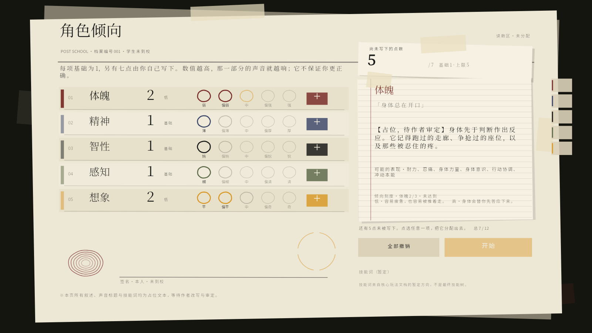

# 五属性加点面板（角色档案页）— Issue #10

> 状态：**代码已写，尚未在 Unity Editor 中编译或运行，也没有截图**。沙箱没有 Unity 6000.3.29f1，因此本文件只描述结构、规则和需要在编辑器里逐项确认的内容，不声称任何视觉验收已通过。

## 目的

Issue #10 要求「制作最小可用角色构建 UI」。上一轮的 `CharacterCreationView` 只是一个能加减点的调试面板；本轮按「参照极乐迪斯科那种形式」的要求，把它重做成一张**贴在桌上的纸质档案页**：五项属性是五条档案行，每行有一条用铅笔圈出的刻度梯，右侧是一栏可以读的说明。视觉语言沿用项目已批准的拼贴／印刷方向（`docs/ART_DIRECTION_EXPERIMENT.md`、`docs/VISUAL_TECHNICAL_DIRECTION.md`）：纸、墨、胶带、彩色铅笔、四分之一环。

借用的只是极乐迪斯科式的**构造语法**——属性行、右侧读数栏、被圈中的数值、档案口吻——不使用它的资源、字体、文案或具体界面。

## 版式打样（不是 Unity 截图）

沙箱没有 Unity，所以用一个离线脚本按**同一套归一化坐标**重画这张纸，用来先发现重叠与溢出：

- 脚本：`docs/images/character-sheet-layout-proof.js`，读取 `Assets/Resources/CharacterSheet/character_sheet_text_placeholder.json`。需要 `@napi-rs/canvas` 与 Noto Sans/Serif SC（SIL OFL 1.1）两个临时依赖，均不进入仓库：
  `npm i @napi-rs/canvas @expo-google-fonts/noto-sans-sc @expo-google-fonts/noto-serif-sc`，然后
  `node docs/images/character-sheet-layout-proof.js Assets/Resources/CharacterSheet/character_sheet_text_placeholder.json /tmp/out`。
- 它模拟了项目的 `CanvasScaler`（`ScaleWithScreenSize`，参考分辨率 1600×900，`matchWidthOrHeight = 0.5`）与 legacy UGUI 的贪心换行，并在 1600×900、1024×768 两个尺寸下报告越界。
- **这张图不是 Unity 渲染结果**，字体、行高、铅笔抖动与真实的 Canvas/字体栅格化会有差异；它只证明版式关系成立，不能当作验收证据。

打样已经发现并修掉的问题：配额数字在票据里偏高被裁切（58→40 号，票据加高）；卡片文字压在印刷的红色边线上（改为从 0.090 起排）；「读数区」小标签压住票据顶边；1024×768 下说明卡与页脚文字溢出（根本原因是字号未按 `uiScale 0.74` 缩放，脚本修正后才看得出来）。

## 规则边界

- 点数预算、上下限、合法性仍只由 `Assets/Scripts/Character/CharacterBuild.cs` 拥有。面板每次加点都先问模型，被拒绝时打印原因并显示在页脚，不会假装成功。
- 五项基础值 1、七点自由分配、暂定上限 5（总值 12）不变。
- 检定是确定性的阈值比较（`AttributeCheckResolver`），面板只做预览，不掷骰、不暗示随机。

## 界面结构

| 区域 | 位置（屏幕归一化坐标） | 内容 |
|---|---|---|
| 桌面色底 | 全屏 | 近黑桌面 + 两张斜贴的纸片 |
| 档案页 | 约 (0.055, 0.045)–(0.945, 0.955)，倾斜 -1° | 纸纤维底色、顶部/右侧胶带、右缘五个索引标签 |
| 页眉 | 页面上方 | 标题、档案副标题、一行说明、手绘横线 |
| 配额票据 | 右上，倾斜 +1.4° | 尚未写下的点数（大号衬线数字）「/ 7　基础 1 · 上限 5」 |
| 属性行 ×5 | 左侧，行高 0.0765、间距 0.0075 | 序号、属性名、大号数值、等级词（基础/低/中/高/极高）、五格铅笔圈刻度、`＋` 加点按钮 |
| 说明卡 | 右侧中部，倾斜 -0.7°，带横格线 | 属性名、声音标题、会换行的叙述、技能词、检定预览与高低倾向注释 |
| 签名区 | 左下 | 指纹、签名线、占位状态说明（`draftNotice`） |
| 页脚 | 右下 | 预算句、总值/剩余、`全部撤销`、`开始` |

## 交互

- 点整行（或数字键 1–5）选中；`Tab` 循环下一项。
- 点该行的 `＋`（或 `=`／小键盘 `+`）加一点到选中项。
- `R` 重置全部点数；`Enter` 开始（七点未分配完时禁用）。
- 加点的同时刷新：数值、等级词、刻度圈填充、配额票据、脚本文案与说明卡。
- 加点瞬间被加的数字有一次性墨点缩放脉冲（`Time.unscaledDeltaTime`，面板自身不暂停时间）。
- 开始后会先锁定面板状态再回调启动器，避免重复应用。

键盘读取复用项目已有的 `UnityEngine.InputSystem`（Input System 1.20.1），没有新增输入资产。

## 刻度梯的含义

五格代表属性值 1–5（不是五个「已花点数」）。因此：

- 新角色每行恰好填满第一格，第二格是「下一个点会落在哪」的预览；
- 达到上限 5 时五格全填，`＋` 禁用；
- 未选中行的预览格很淡，选中行用赭黄提示。

这条规则写在 `CharacterSheetRules.IsFilled` / `IsPreviewSlot`，并有 EditMode 测试锁定（上一版曾用「已花点数」口径，导致 1 点显示为空梯，已修正）。

## 文案与数据

- 所有会出现在页面上的文字都在 `Assets/Resources/CharacterSheet/character_sheet_text_placeholder.json`，由 `CharacterSheetText` 解析、`CharacterSheetText.Validate` 校验。
- 文件头 `status` 为 `placeholder_pending_owner_text`，页面左下也印了 `draftNotice`。**面板上的叙述、声音标题（如「身体总在开口」）、高低倾向注释全部是我写的占位文本，等待作者改写或替换，不是作者定稿。**
- 属性名与技能词来自 `docs/CORE_GAMEPLAY.md` 的已批准内容；技能词仍标为暂定。
- 数值、等级词、配额、检定预览由代码生成，不在 JSON 里重复维护。

## 字体

项目没有字体资源，此前全部使用内置 Arial（中文缺字时依赖操作系统回退）。`Assets/Scripts/UI/UiTypeface.cs` 现在按优先级请求操作系统字体：

- 标题（衬线）：Source Han Serif SC / Noto Serif CJK SC / Songti SC / STSong / SimSun / Times New Roman；
- 正文（无衬线）：Source Han Sans SC / Noto Sans CJK SC / Microsoft YaHei / PingFang SC / Hiragino Sans GB / SimHei / WenQuanYi Micro Hei / Arial。

**没有把任何字体文件放进仓库**，也没有做字体的清权。若目标机器缺少上述字体，会退回内置 Arial 并打印警告；此时中文可能显示为方块。要正式发布，需要由 owner 选择并清权一个可再分发的简体中文字体，再在 `docs/ASSET_PROVENANCE.md` 登记。

## 美术资源

页面上的纸、胶带、铅笔圈、四分之一环、指纹、索引标签、横线全部是 `SheetGraphic`（`Graphic` 子类）在 `OnPopulateMesh` 里生成的顶点几何，没有引入任何贴图、模型或第三方资源。因此本轮不需要新的来源登记，但仍不是最终美术。

## 新增与改动文件

| 文件 | 作用 |
|---|---|
| `Assets/Scripts/UI/CharacterSheetView.cs` | 面板本体：布局、刷新、输入、加点动画 |
| `Assets/Scripts/UI/CharacterSheetRules.cs` | 刻度、等级词、阈值文案、预算句、换行与字距等可测规则 |
| `Assets/Scripts/UI/CharacterSheetText.cs` | 文案数据模型与校验 |
| `Assets/Scripts/UI/CharacterSheetPalette.cs` | 纸／墨／铅笔色定义与灰度工具 |
| `Assets/Scripts/UI/SheetGraphic.cs` | 程序化纸质图形 |
| `Assets/Scripts/UI/SheetWidgets.cs` | 印刷风控件构造（文本、标签、按钮、命中区、倾斜） |
| `Assets/Scripts/UI/UiTypeface.cs` | 操作系统字体解析与回退 |
| `Assets/Resources/CharacterSheet/character_sheet_text_placeholder.json` | 占位文案 |
| `Assets/Scripts/Prototype/PrototypeSceneBootstrap.cs` | 改为加载档案页文案并挂载 `CharacterSheetView`；面板可见时不再刷新交互提示 |
| `Assets/Scripts/Prototype/PrototypeUiFactory.cs`、`DialoguePresenter.cs` | 字体改用 `UiTypeface.Sans`（顺带修掉对话长栏的中文缺字风险） |
| `Assets/Tests/EditMode/CharacterSheetRulesTests.cs` | 刻度、预览、上限、等级词、预算句、阈值文案、换行 |
| `Assets/Tests/EditMode/CharacterSheetContentTests.cs` | 占位文案校验、每项五格梯与文案长度、颜色对灰度对比 |

`Assets/Scripts/Prototype/CharacterCreationView.cs` 已删除（由 `CharacterSheetView` 取代）。同步 `main` 时保留了 `main` 新增的序章动画、`ProceduralStudentModelFactory` 与 `PrototypeSaveStore` 存档流程：读档后调用 `CharacterSheetView.RefreshFromModel()` 重建显示，保存/读取结果通过 `SetFeedback()` 显示在页脚预留的一行状态位（不再像旧面板那样多出一条调试文字）。

## 验证状态

已实际执行（在沙箱内）：

- `python3 tools/check_unity_project.py --check`：通过（185 个跟踪文件，其中 127 个在 `Assets/`）。
- `python3 -m unittest discover -s tests/ci -p 'test_*.py'`：20 项通过。
- 新增 `.cs`／`.meta`／文件夹 `.meta` 的 GUID 唯一性与格式由上面第一项检查覆盖。
- 纯 Python 的结构体检：所有 `.cs` 花括号/圆括号/方括号配平、无制表符、无行尾空白、无 CR。

**未执行**（沙箱无 Unity）：

1. Unity 6000.3.29f1 的脚本编译与导入；`SheetGraphic`、`CharacterSheetView` 是否有编译或 API 版本问题。
2. `Assets/Tests/EditMode` 中新增两个测试文件的实际运行结果；文中对 `Resources.Load`、`JsonUtility.ToJson`、`CollectionAssert` 等 API 的用法尚未被 Unity 验证。
3. Play Mode 下的实际观感：倾斜纸面是否造成文字发虚、字号在 1024×768 与 1920×1080 下是否可读、长段中文是否溢出说明卡。
4. 中文字体在实际 Windows 机器上的解析结果。

## 需要在编辑器中手动确认

1. 进入 Play Mode，页面应直接覆盖在教室灰盒之上；五个属性各显示 1、`基础`、第一格铅笔圈为实、第二格为淡预览。
2. 点 `＋` 或按 `=`：数字加一、对应的圈变成该属性的铅笔色、配额数字减一。
3. 把某项加到 5：该行五格全满，`＋` 变灰，页脚给出提示。
4. 用 `全部撤销` 归零；再把七点分配完，`开始` 变为可点。注意第一点加在 `体魄` 上时**第一次点击即生效**（`Enter` 会直接开始），因为启动器默认选中第一项；若担心误触发，可改用 `Tab`/数字键先选中再按 `=`。
5. 点 `开始`：页面消失、玩家可移动、`E` 可触发 Q 对话；返回后不再出现面板。
6. 用 1024×768 与 1920×1080 各截一张图，确认没有文字互相覆盖、说明卡没有溢出。

## 已知限制与待 owner 决定

- 没有渐进出现／缩放消隐等过渡动画，只有加点的墨点脉冲。
- 没有音效；没有「撤销单点」，只有全部撤销（`CharacterBuild.TryAdjust(-1)` 已支持，但面板未暴露每个点的减号，避免二次确认负担）。
- 进入面板时默认选中第一项（体魄），因此打开后直接按 `Enter` 会立刻开始；这是有意的快捷键设计，但可能被误触。
- 索引标签目前只是装饰，不可点击切换。
- 说明卡里的检定预览用的是「当前值 +1」的目标，属于原型表达，不是最终数值设计。
- 需要 owner 决定：是否接受纸质档案方向；五段叙述与五个声音标题的占位是否保留结构（我会替换为作者文本）；是否引入并清权一个中文字体；是否需要逐点撤销与动画过渡。
